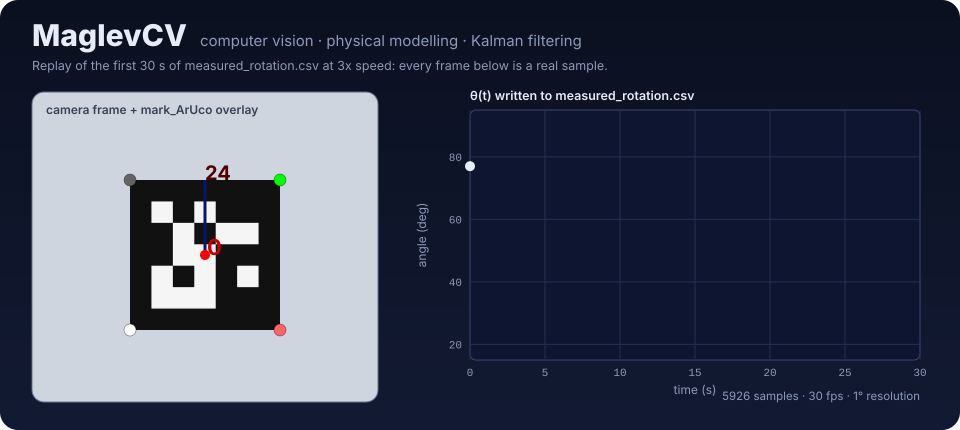
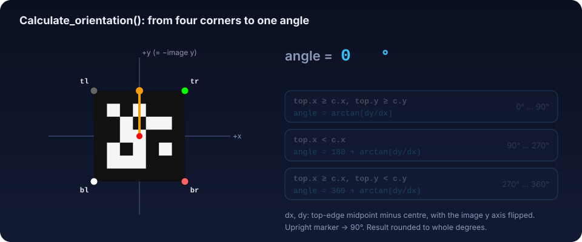
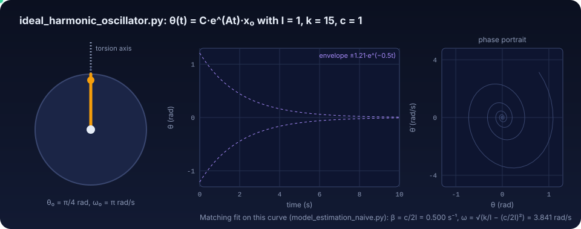
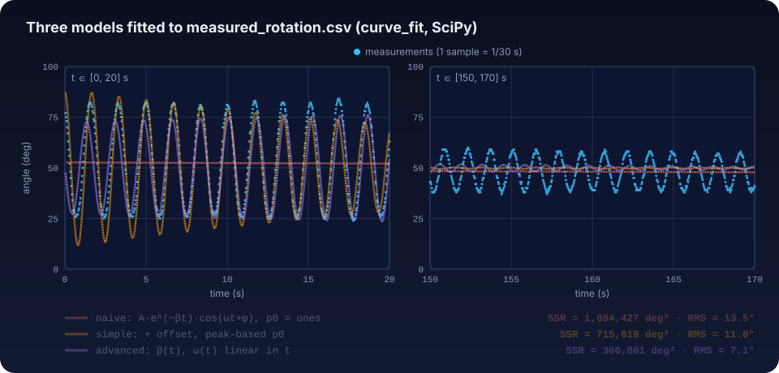
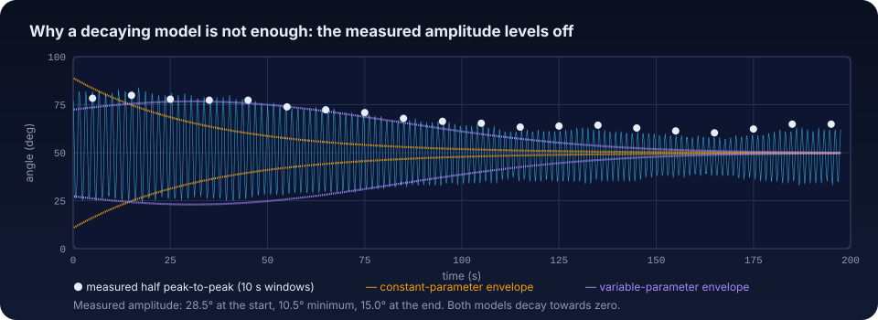

<p align="center">
  
</p>

<p align="center">
  <b>Track the rotation of a levitating magnet with a camera, model it as a damped oscillator,
  and fuse model and measurements with a Kalman filter.</b>
</p>

<p align="center">
  <a href="https://cocopops9.github.io/MaglevCV/"></a>
  <a href="docs/README.md"></a>
  
  
</p>

The animation above is real data: the marker is rotated frame by frame by the first 30 s of
[`measured_rotation.csv`](measured_rotation.csv) (3× speed), with the overlay drawn in the exact colours used
by `aruco_library.mark_ArUco`. Every figure in this README is generated from the repository's own code and
data by [`docs/tools/build_figures.py`](docs/tools/build_figures.py).

> **Try it yourself.** The [interactive lab](https://cocopops9.github.io/MaglevCV/) runs the project's
> algorithms in your browser on the real dataset: rotate a marker and watch the angle code take its branches,
> tune the adaptive threshold, drive the oscillator, run Levenberg–Marquardt iteration by iteration, and tune
> the Kalman filter by maximum likelihood. If GitHub Pages is not enabled yet, use
> [this mirror](https://raw.githack.com/cocopops9/MaglevCV/main/docs/index.html).

## Contents

1. [How it works](#how-it-works) · the pipeline in five animated steps
2. [Results](#results)
3. [Usage](#usage) · installation, configuration, running each script
4. [Repository layout](#repository-layout)
5. [Limitations](#limitations)
6. [Guided documentation](#guided-documentation)

---

## How it works

<p align="center">
  
</p>

The project is a linear pipeline: each stage writes a CSV that the next stage reads.

### 1 · Detect the marker in every frame

<p align="center">
  
</p>

`aruco_library.detect_ArUco()` converts the frame to grayscale and calls `cv2.aruco.detectMarkers` with the
`DICT_5X5_50` dictionary and default parameters. OpenCV binarises the image with an adaptive mean threshold,
keeps convex quadrilateral contours, removes the perspective, reads the 7×7 cell grid and matches the inner
5×5 bits against the dictionary in all four rotations. The result is the marker id and its four corners,
ordered **in the marker's own frame** (top-left, top-right, bottom-right, bottom-left), so the marker's top is
known even when it is upside down.

<details>
<summary><b>Show the code</b></summary>

```python
def detect_ArUco(img):
    Detected_ArUco_markers = {}
    aruco_dict = aruco.getPredefinedDictionary(aruco.DICT_5X5_50)
    gray = cv2.cvtColor(img, cv2.COLOR_BGR2GRAY)
    parameters = cv2.aruco.DetectorParameters()
    corners, ids, _ = aruco.detectMarkers(gray, aruco_dict, parameters=parameters)
    for i in range(len(ids)):
        Detected_ArUco_markers.update({ids[i][0]: corners[i]})
    return Detected_ArUco_markers
```
</details>

→ [Chapter 2 · ArUco detection](docs/02-aruco-detection.md) · [Lab step 1](https://cocopops9.github.io/MaglevCV/#detect)

### 2 · Turn four corners into one angle

<p align="center">
  
</p>

`Calculate_orientation()` takes the vector from the marker centre (mean of the corners) to the midpoint of
its top edge, flips the image $y$ axis, and computes $\arctan(\Delta y/\Delta x)$. Three branches extend the
$(-90°, 90°)$ range of the arctangent to a full turn; the value is rounded to a whole degree before the
branch offset is added. An upright marker reads 90°. `maglev_rotation_CV.py` stores
`(frame_number / FPS, angle)` for every frame in `measured_rotation.csv`: 5926 samples at 30 Hz, 197.5 s.

<details>
<summary><b>Show the code</b></summary>

```python
top = (tl[0] + tr[0]) / 2, -((tl[1] + tr[1]) / 2)
centre = (tl[0] + tr[0] + bl[0] + br[0]) / 4, -((tl[1] + tr[1] + bl[1] + br[1]) / 4)
angle = round(math.degrees(np.arctan((top[1] - centre[1]) / (top[0] - centre[0]))))
if (top[0] >= centre[0] and top[1] < centre[1]):
    angle = 360 + angle
elif (top[0] < centre[0]):
    angle = 180 + angle
```
</details>

→ [Chapter 3 · Angle extraction](docs/03-angle-extraction.md) · [Lab step 2](https://cocopops9.github.io/MaglevCV/#angle)

### 3 · Model the physics

<p align="center">
  
</p>

The magnet is modelled as a damped torsional oscillator, $I\ddot\theta + c\dot\theta + k\theta = 0$.
`ideal_harmonic_oscillator.py` writes it as $\dot x = Ax$ with $x = [\theta, \dot\theta]^T$ and
$`A = \begin{bmatrix}0 & 1\\ -k/I & -c/I\end{bmatrix}`$, and evaluates the exact solution
$\theta(t) = C e^{At} x_0$ with `scipy.linalg.expm`. The animation uses the script's values
($I = 1$, $k = 15$, $c = 1$, $\theta_0 = \pi/4$, $\omega_0 = \pi$). In the under-damped case the same curve is
$A_0 e^{-\beta t}\cos(\omega t + \varphi)$ with $\beta = c/2I$ and $\omega = \sqrt{k/I - \beta^2}$: the form
used by every fitting script.

→ [Chapter 4 · Physical model](docs/04-physical-model.md) · [Lab step 3](https://cocopops9.github.io/MaglevCV/#physics)

### 4 · Fit the model to the measurements

<p align="center">
  
</p>

`scipy.optimize.curve_fit` (Levenberg–Marquardt) minimises the squared residuals. Because it only finds the
nearest local minimum, the three estimators differ in model and starting point:

| Script | Model | Initial guess | SSR (deg²) |
|--------|-------|---------------|-----------:|
| `model_estimation_naive_4real_data.py` | $A e^{-\beta t}\cos(\omega t+\varphi)$ | all ones | 1,084,427 |
| `model_estimanion_simple.py` | $\dots + \text{offset}$ | from the signal's peaks (log decrement, peak spacing) | 715,619 |
| `model_estimanion_advanced.py` | $\beta(t) = \beta_0 + \beta_1 t$, $\omega(t) = \omega_0 + \omega_1 t$ | peaks + drift estimates | 300,861 |

The naive estimator recovers the simulated oscillator exactly (`model_estimation_naive.py`), but fails on real
data, which oscillate around ≈ 50°. Even the best model leaves periodic residuals: the measured amplitude
levels off and grows again, which no exponentially decaying model can follow.

<p align="center">
  
</p>

→ [Chapter 5 · Parameter estimation](docs/05-parameter-estimation.md) · [Lab step 4](https://cocopops9.github.io/MaglevCV/#fitting)

### 5 · Fuse model and measurements with a Kalman filter

<p align="center">
  
</p>

`Kalman.py` estimates the state $[\theta, \dot\theta]$ with the transition
$`F_k = \begin{bmatrix}1 & \Delta t\\ 0 & 1 - \beta(t_k)\Delta t\end{bmatrix}`$ built from the advanced fit,
the measurement noise $\sigma_z$ taken from that fit's residuals, and process noise $Q = \operatorname{diag}(0, \sigma_q^2)$.
$\sigma_q$ is chosen by running the filter for 50 log-spaced values and maximising the Gaussian
log-likelihood of the innovations:

<p align="center">
  
</p>

<p align="center">
  
</p>

<details>
<summary><b>Show the filter loop</b></summary>

```python
for k in range(len(time)):
    beta_tk = beta0 + beta1 * time[k]
    F_k = np.array([[1, dt], [0, 1 - beta_tk * dt]])
    x_pred = F_k @ x_est                      # predict
    P_pred = F_k @ P_est @ F_k.T + Q
    y_k = z_k - (H @ x_pred)[0]               # innovation
    S_k = (H @ P_pred @ H.T + R)[0, 0]
    K_k = (P_pred @ H.T) / S_k                # gain
    x_est = x_pred + K_k[0, 0] * y_k          # update (see docs, chapter 6.4)
    P_est = (np.eye(2) - K_k @ H) @ P_pred
    log_likelihood += -0.5 * (np.log(2 * np.pi * S_k) + y_k**2 / S_k)
```
</details>

→ [Chapter 6 · Kalman filter](docs/06-kalman-filter.md) · [Lab step 5](https://cocopops9.github.io/MaglevCV/#kalman)

---

## Results

Values obtained by running the scripts on `measured_rotation.csv` (reproduced by
`docs/tools/build_figures.py`):

| Quantity | Value |
|----------|-------|
| Samples / rate / resolution | 5926 / 30 Hz / 1° |
| Simple fit: $\beta$, $\omega$, offset | 0.0297 s⁻¹, 3.732 rad/s, 49.8° |
| Advanced fit: $\beta_0$, $\beta_1$, $\omega_0$, $\omega_1$ | −0.0113 s⁻¹, 1.83·10⁻⁴ s⁻², 3.541 rad/s, 4.12·10⁻³ rad/s² |
| RMS residual: naive / simple / advanced | 13.5° / 11.0° / 7.1° |
| Kalman: $\sigma_z$, optimal $\sigma_q$, max log-likelihood | 7.13°, 0.494, 4661.6 |
| Kalman: RMSE (estimate vs measurement), innovation std, SNR | 2.69°, 4.52°, 17.21 dB |

A discussion of what these numbers mean, and of what the model does not capture, is in
[chapter 7](docs/07-results-and-limitations.md).

---

## Usage

### Requirements

* Python 3 with NumPy, SciPy, Matplotlib
* `opencv-contrib-python` **4.7 or later, but below 5**: the code uses the legacy function
  `cv2.aruco.detectMarkers` (present in the 4.x contrib wheels, removed in OpenCV 5) together with the
  `DetectorParameters()` constructor (introduced in 4.7).

```bash
git clone https://github.com/cocopops9/MaglevCV.git
cd MaglevCV
python -m venv .venv && source .venv/bin/activate     # Windows: .venv\Scripts\activate
pip install -r requirements.txt
```

### Configure the paths

The scripts contain absolute Windows paths from the original thesis setup. Before running a script, edit
the variables below so they point at your files (relative paths such as `'measured_rotation.csv'` work when
you run from the repository root).

| Script | Variable(s) to edit | Reads | Writes |
|--------|--------------------|-------|--------|
| `maglev_rotation_CV.py` | argument of `cv2.VideoCapture(...)`, of `cv2.VideoWriter(...)`, of `open(...)` | your video (one ArUco `DICT_5X5_50` marker visible in every frame) | annotated `.avi`, `measured_rotation.csv` |
| `ideal_harmonic_oscillator.py` | `csv_filename` (and `I`, `k_rot`, `c_rot`, initial conditions) | – | `ideal_damped_harmonic_oscillator_response.csv` (time, θ in rad) |
| `model_estimation_naive.py` | `filename`, `output_filename` | the ideal response CSV | `parameters.csv` |
| `model_estimation_naive_4real_data.py` | `filename`, `param_filename` | `measured_rotation.csv` | `parameters_naive.csv` |
| `model_estimanion_simple.py` | `filename`, `param_filename` | `measured_rotation.csv` | `parameters_constant.csv` |
| `model_estimanion_advanced.py` | `filename`, `param_filename` | `measured_rotation.csv` | `parameters.csv` (= `parameters_variable.csv` in this repo) |
| `Kalman.py` | `param_file`, `data_file` | **variable-parameter** file (keys `beta0`, `beta1`, ...) and `measured_rotation.csv` | – (plots and printed metrics) |

### Run the pipeline

```bash
# 1. Video -> angle time series (opens a preview window; press q to stop early)
python maglev_rotation_CV.py

# 2. Optional validation on synthetic data
python ideal_harmonic_oscillator.py
python model_estimation_naive.py

# 3. Model fitting on the measured series
python model_estimation_naive_4real_data.py   # shows why the naive approach fails
python model_estimanion_simple.py             # constant parameters
python model_estimanion_advanced.py           # time-varying parameters

# 4. Kalman filtering (param_file -> the advanced parameters)
python Kalman.py
```

The repository already contains the outputs of steps 1 and 3 (`measured_rotation.csv`,
`parameters_constant.csv`, `parameters_variable.csv`), so steps 3 and 4 can be run without the video.

### What each script shows

| Script | Console output | Figures |
|--------|----------------|---------|
| `maglev_rotation_CV.py` | – | live annotated video; angle vs time |
| `ideal_harmonic_oscillator.py` | – | $\theta(t)$ with $\alpha$, $\beta$, $\theta_0$, $\omega_0$ |
| `model_estimation_naive.py` | fitted $A, \beta, \omega, \varphi$ | data vs fit; residuals |
| `model_estimation_naive_4real_data.py` | SSR, parameters | data vs fit; residuals |
| `model_estimanion_simple.py` | SSR, parameters | data vs fit (annotated); residuals |
| `model_estimanion_advanced.py` | SSR (printed in Italian) | data vs fit; residuals; $\beta(t)$; $\omega(t)$ |
| `Kalman.py` | $\sigma_z$, optimal $\sigma_q$, max log-likelihood, innovation mean/std, SNR, RMSE | measurements vs model; likelihood vs $\sigma_q$; measurements vs estimates; residuals; innovations; estimates vs model; residuals vs model |

### Data formats

All CSV files have no header.

| File | Columns |
|------|---------|
| `measured_rotation.csv` | `time_s, angle_deg` (integer degrees, 0 to 360) |
| ideal response CSV | `time_s, theta_rad` |
| `parameters_constant.csv` | `name, value` for `A, beta, omega, phi, offset` (radians, seconds) |
| `parameters_variable.csv` | `name, value` for `A, beta0, beta1, omega0, omega1, phi, offset` |

### Rebuild the figures and the lab data

```bash
python docs/tools/build_figures.py   # regenerates docs/assets/*.svg and docs/lab/data.js
node docs/tools/verify_lab.js        # checks the lab's JavaScript port against the Python results
python -m http.server -d docs 8000   # serve the interactive lab at http://localhost:8000
```

---

## Repository layout

```text
MaglevCV/
├── aruco_library.py                       # detection, angle computation, overlay drawing
├── maglev_rotation_CV.py                  # video -> measured_rotation.csv
├── ideal_harmonic_oscillator.py           # exact response via the matrix exponential
├── model_estimation_naive.py              # fit on the ideal response (validation)
├── model_estimation_naive_4real_data.py   # same fit on real data (fails)
├── model_estimanion_simple.py             # constant-parameter fit with peak-based guess
├── model_estimanion_advanced.py           # time-varying-parameter fit
├── Kalman.py                              # Kalman filter with likelihood-tuned process noise
├── measured_rotation.csv                  # real dataset (5926 samples)
├── parameters_constant.csv                # output of the simple fit
├── parameters_variable.csv                # output of the advanced fit
├── requirements.txt
└── docs/
    ├── README.md, 01-...07-*.md           # guided documentation
    ├── index.html, lab/                   # interactive lab (static, no build)
    ├── assets/                            # animated SVG figures
    └── tools/                             # figure generator and lab verification
```

## Limitations

The main ones, discussed with their consequences in [chapter 7](docs/07-results-and-limitations.md):
hard-coded paths; `detect_ArUco` raises `TypeError` on a frame without markers; only the first detected
marker is recorded; the angle is an in-plane image angle (no camera calibration); the Kalman transition
matrix has no restoring term and its state update applies the angle gain $K[0]$ to both states
([chapter 6.4](docs/06-kalman-filter.md#64-implementation-notes-what-the-code-actually-does)).

## Guided documentation

The [`docs/`](docs/README.md) folder explains the algorithms in pipeline order, one question per chapter:

1. [Overview](docs/01-overview.md)
2. [ArUco detection](docs/02-aruco-detection.md)
3. [Angle extraction](docs/03-angle-extraction.md)
4. [Physical model](docs/04-physical-model.md)
5. [Parameter estimation](docs/05-parameter-estimation.md)
6. [Kalman filter](docs/06-kalman-filter.md)
7. [Results and limitations](docs/07-results-and-limitations.md)
