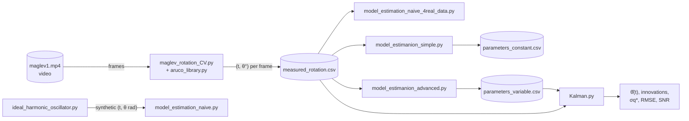

# 1 · Overview: from a video to a filtered state

[Guide index](README.md) · Next: [2 · ArUco detection →](02-aruco-detection.md)

  

## The physical question

A permanent magnet levitates and is free to rotate. An ArUco marker is attached to it, and a camera films
it. When disturbed, the magnet oscillates in rotation around a rest orientation and the oscillation slowly
changes over time. MaglevCV answers three questions with this video:

1. **What is the rotation angle in every frame?** (computer vision)
2. **Which differential equation describes that angle, and with which parameters?** (modelling and
   non-linear least squares)
3. **What is the best estimate of the true angle, given an imperfect model and noisy measurements?**
   (Kalman filtering)

The animation above is not a simulation: the marker is rotated, frame by frame, by the first 30 seconds
of `measured_rotation.csv`, and the overlay uses the exact colours of `aruco_library.mark_ArUco`.

## The pipeline and its hand-offs

| Stage | Input | Output | Chapter |
|-------|-------|--------|---------|
| Detection | BGR frame | `{id: 4 corners}` | [2](02-aruco-detection.md) |
| Angle | 4 corners | integer angle in $[0, 360]$ degrees | [3](03-angle-extraction.md) |
| Recording | angle of the first detected marker, frame number | `measured_rotation.csv`: `time_s, angle_deg` | [3](03-angle-extraction.md) |
| Modelling | physical parameters $I, k, c$ | $\theta(t) = C e^{At} x_0$ (validation data) | [4](04-physical-model.md) |
| Fitting | `(t, θ)` | $A, \beta, \omega, \varphi$, offset (and drifts) | [5](05-parameter-estimation.md) |
| Filtering | `(t, θ)` + variable-parameter model | $\hat\theta_k$, innovations, optimal $\sigma_q$ | [6](06-kalman-filter.md) |

## The dataset in numbers

| Quantity | Value |
|----------|-------|
| Samples | 5926, one per frame, no missing frames |
| Sampling | $\Delta t = 1/30$ s (time = frame number / FPS, so the first sample is at 0.0333 s) |
| Duration | 197.5 s |
| Range | 24° to 84°, integers only (resolution 1°) |
| Mean angle | ≈ 50° (the rest orientation) |

## Technologies

| Technology | Used for | Where |
|------------|----------|-------|
| OpenCV (`cv2`, `cv2.aruco`) | video I/O, grayscale conversion, marker detection, drawing | `aruco_library.py`, `maglev_rotation_CV.py` |
| NumPy | arrays, `arctan`, statistics | everywhere |
| SciPy | `linalg.expm`, `optimize.curve_fit` (Levenberg–Marquardt), `signal.find_peaks` | modelling and fitting |
| Matplotlib | every plot the scripts display | everywhere |
| `csv` (standard library) | the hand-off format between stages | everywhere |

Next: [2 · ArUco detection →](02-aruco-detection.md)
