# 2 · ArUco detection: finding the marker in a frame

[← 1 · Overview](01-overview.md) · [Guide index](README.md) · Next: [3 · Angle extraction →](03-angle-extraction.md)

**Question:** given one video frame, where are the four corners of the marker, and which marker is it?
**Code:** `aruco_library.detect_ArUco(img)` · **Lab:** [step 1](https://cocopops9.github.io/MaglevCV/#detect)

```python
aruco_dict = aruco.getPredefinedDictionary(aruco.DICT_5X5_50)
gray = cv2.cvtColor(img, cv2.COLOR_BGR2GRAY)
parameters = cv2.aruco.DetectorParameters()
corners, ids, _ = aruco.detectMarkers(gray, aruco_dict, parameters=parameters)
for i in range(len(ids)):
    Detected_ArUco_markers.update({ids[i][0]: corners[i]})
```

The project calls OpenCV's detector with its **default parameters**, so everything below describes what
OpenCV does with those defaults.

<p align="center">
  
</p>

Every image in this animation is a real OpenCV output, produced by `docs/tools/build_figures.py` on a
synthetic frame (a marker rendered in perspective with blur, an illumination gradient and noise); step 7 is
`aruco_library.mark_ArUco` itself.

## 2.1 What an ArUco marker is

An ArUco marker is a square grid of black and white cells: a black border one cell wide and an inner
$n\times n$ binary code. `DICT_5X5_50` contains 50 markers with a $5\times 5$ code, so each marker is a
$7\times 7$ grid. The 50 codes were chosen so that

* they are far apart in Hamming distance, which allows some wrong bits to be corrected;
* none of them equals a rotation of itself or of another code, so the detected bit pattern also tells
  **which side is the top**.

The second property is what makes a full 360° angle measurement possible in chapter 3.

## 2.2 The detection chain

| Step | Operation | Default parameter(s) |
|------|-----------|----------------------|
| 1 | `cv2.cvtColor(BGR → GRAY)` (done in `detect_ArUco`) | – |
| 2 | Adaptive threshold, mean of a $w\times w$ window minus $C$, inverted | $w = 3, 13, 23$ (`adaptiveThreshWinSizeMin/Max/Step` = 3/23/10), $C = 7$ |
| 3 | `findContours` on each binary image | – |
| 4 | Keep contours with a plausible perimeter, approximate with `approxPolyDP`, keep convex 4-gons | perimeter between 0.03 and 4 × the largest image side; accuracy 0.03 × perimeter |
| 5 | Reject near-duplicates and candidates too close to the border | `minCornerDistanceRate` 0.05, `minDistanceToBorder` 3 px |
| 6 | Perspective removal: homography from the 4 corners to a canonical square, 4 px per cell | `perspectiveRemovePixelPerCell` = 4 |
| 7 | Otsu threshold of the canonical image, majority vote per cell ignoring a 13 % margin | `perspectiveRemoveIgnoredMarginPerCell` = 0.13 |
| 8 | Check that the border cells are black | up to 35 % wrong border bits (`maxErroneousBitsInBorderRate`) |
| 9 | Compare the inner bits with the dictionary in the 4 rotations, accept the closest within the correction budget | `errorCorrectionRate` = 0.6 |
| 10 | Reorder the corners so that the first one is the marker's own top-left | – |

No sub-pixel corner refinement is applied (`cornerRefinementMethod` defaults to `CORNER_REFINE_NONE`), so the
corners have the precision of the contour approximation.

### Why an adaptive threshold

A global threshold $T$ classifies a pixel as dark when $I(x,y) < T$. With uneven lighting, the dark side of
the white paper can be darker than the bright side of the black border, and no single $T$ separates them.
The adaptive threshold compares each pixel with its own neighbourhood:

```math
\text{foreground}(x,y) \iff I(x,y) \le \frac{1}{w^2}\sum_{(u,v)\in \mathcal N_w(x,y)} I(u,v) \; - \; C .
```

The constant $C$ suppresses the noise of flat regions (a pixel must be clearly darker than its
surroundings). Several window sizes are tried because the right $w$ depends on the marker's size in pixels.
The lab lets you change $w$, $C$, the illumination gradient and the noise, and compare with a global Otsu
threshold.

### Why the corner order matters

After identification OpenCV returns `corners[i]` as an array of shape `(1, 4, 2)`, ordered
**top-left, top-right, bottom-right, bottom-left of the marker itself**, not of the image. If the marker is
upside down in the image, its "top-left" corner is at the bottom right of the picture. Chapter 3 relies on
this: the top edge is always the segment `corners[0][0] → corners[0][1]`.

## 2.3 What `maglev_rotation_CV.py` does with the result

For each frame of the video:

1. `detect_ArUco(frame)` → `{id: corners}`
2. `Calculate_orientation(...)` → `{id: angle}` (chapter 3)
3. `mark_ArUco(...)` draws the overlay (corner dots, centre, top-to-centre line, id and angle) on the frame,
   which is shown with `cv2.imshow` and written to an XVID `.avi`;
4. if at least one marker was found, the angle of the **first** detected id is appended to the CSV with
   `time = frame_number / FPS`.

## 2.4 Practical notes

* `aruco.detectMarkers` is the legacy function of the `cv2.aruco` module. It is present in the
  `opencv-contrib-python` 4.x wheels (checked on 4.10 to 4.12) and absent from OpenCV 5.0; the
  `DetectorParameters()` constructor requires OpenCV ≥ 4.7. Hence `opencv-contrib-python>=4.7,<5` in
  `requirements.txt`.
* When a frame contains no marker, `detectMarkers` returns `ids = None` and `len(ids)` raises
  `TypeError`. The recorded video has a marker in every frame (5926 consecutive samples), so this never
  triggered; see [chapter 7](07-results-and-limitations.md).

**Hand-off to chapter 3:** for each frame, the four corners (pixels, image coordinates with $y$ pointing down)
of the marker, in the marker's own order.

[← 1 · Overview](01-overview.md) · Next: [3 · Angle extraction →](03-angle-extraction.md)
