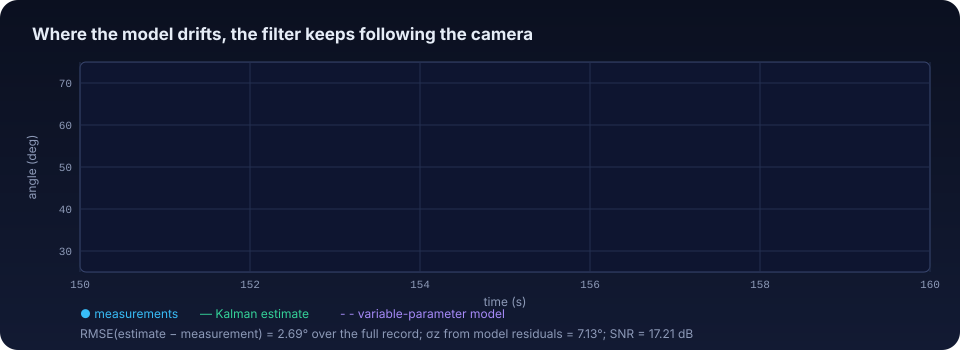

# 6 · Kalman filter: fusing the model with the measurements

[← 5 · Parameter estimation](05-parameter-estimation.md) · [Guide index](README.md) · Next: [7 · Results and limitations →](07-results-and-limitations.md)

**Question:** given an imperfect model and noisy measurements, what is the best running estimate of the angle?
**Code:** `Kalman.py` · **Lab:** [step 5](https://cocopops9.github.io/MaglevCV/#kalman)

<p align="center">
  
</p>

## 6.1 The idea

A Kalman filter keeps a Gaussian belief about a hidden state: a mean $\hat x_k$ and a covariance $P_k$. At
every sample it

1. **predicts** where the state goes according to a model, and grows the uncertainty by the process noise $Q$;
2. **compares** the prediction with the measurement (the *innovation*);
3. **updates** the mean by a fraction $K$ of the innovation, where the gain $K$ weighs the prediction's
   uncertainty against the measurement noise $R$.

For linear models with Gaussian noise this is the minimum-variance estimator. Its quality depends on $Q$
and $R$, which `Kalman.py` sets from the data.

## 6.2 The filter as written in `Kalman.py`

**State and measurement.** $x = [\theta,\ \dot\theta]^T$ in radians; only the angle is measured:
$H = [1\ \ 0]$.

**Measurement noise.** $R = \sigma_z^2$, with $\sigma_z$ the standard deviation of the residuals between the data
and the variable-parameter model of chapter 5: $\sigma_z = 0.1244$ rad $= 7.13°$. This value includes the model
mismatch, so it is much larger than the camera's own noise.

**Transition.** With $\beta(t_k) = \beta_0 + \beta_1 t_k$ from `parameters_variable.csv`,

```math
F_k = \begin{bmatrix} 1 & \Delta t \\ 0 & 1 - \beta(t_k)\,\Delta t \end{bmatrix}, \qquad
Q = \begin{bmatrix} 0 & 0 \\ 0 & \sigma_q^2 \end{bmatrix}.
```

**Initialisation.** $\hat x_0 = [\theta_0,\ (\theta_1 - \theta_0)/\Delta t]$, $P_0 = I$.

**Loop**, for $k = 0 \dots 5925$:

```math
\begin{aligned}
x_k^- &= F_k\,\hat x_{k-1}, & P_k^- &= F_k P_{k-1} F_k^T + Q \\
y_k &= z_k - H x_k^-, & S_k &= H P_k^- H^T + R \\
K_k &= P_k^- H^T / S_k, & \hat x_k &= x_k^- + K_k[0]\; y_k \quad(\text{see 6.4}) \\
P_k &= (I - K_k H)\,P_k^-, & \ell &\mathrel{+}= -\tfrac12\left[\ln(2\pi S_k) + y_k^2/S_k\right]
\end{aligned}
```

## 6.3 Choosing $\sigma_q$ by maximum likelihood

If the filter is consistent, the innovations are independent Gaussians $y_k \sim \mathcal N(0, S_k)$, and

```math
\ell(\sigma_q) = \sum_k -\tfrac12\left[\ln(2\pi S_k) + \frac{y_k^2}{S_k}\right]
```

is the log-likelihood of the whole record. `Kalman.py` runs the filter for 50 values
`np.logspace(-7, 1, 50)` (from $10^{-7}$ to $10$; the comment in the code says $10^{-8}$ to $10^0$) and keeps
the maximum.

<p align="center">
  
</p>

| Result (as written in `Kalman.py`) | Value |
|------------------------------------|-------|
| optimal $\sigma_q$ on the grid | 0.4942 |
| maximum log-likelihood | 4661.62 |
| innovations: mean / std | 0.031° / 4.521° |
| RMSE between estimate and measurement | 0.0470 rad = 2.69° |
| SNR $= 10\log_{10}(\overline{\theta^2}/\sigma_z^2)$ | 17.21 dB |

Small $\sigma_q$ means "trust the model": the estimate follows $F_k$ and drifts away from the data, so the
innovations are large and the likelihood is low (left plateau). Large $\sigma_q$ means "trust the camera":
$S_k$ grows and the $\ln S_k$ term penalises the likelihood (right side). The optimum balances the two.

<p align="center">
  
</p>

In the window above (150–160 s) the variable-parameter model has almost no amplitude and the wrong phase,
yet the filter estimate stays on the measurements: the process noise lets the velocity state absorb what
the model does not explain.

## 6.4 Implementation notes (what the code actually does)

These points are stated so that the figures and the lab can be read correctly; the lab reproduces the code
as written and offers the textbook variant only as a comparison.

1. **No restoring term in $F_k$.** `omega_tk` is computed in the loop but never used. $F_k$ is the transition of a
   free rotor with linear friction (constant velocity, slowly damped), not of the oscillator of chapter 4,
   whose discretisation would contain $-\omega^2\Delta t$ in position (2,1). The oscillation is therefore
   carried entirely by the measurements and by the process noise, which is why the optimal $\sigma_q$ is
   large (0.49 rad/s per step).
2. **Scalar gain in the update.** `x_est = x_pred + K_k[0,0] * y_k` adds the same scalar
   $K_k[0]\,y_k$ to both components; the textbook update is $\hat x = x^- + K_k\,y_k$, which corrects the
   velocity with $K_k[1]$. The covariance update $(I - K_kH)P_k^-$ uses the full gain, so the two are not
   consistent. With the textbook update the grid optimum becomes $\sigma_q = 0.339$, the log-likelihood rises
   to 5217.8 and the RMSE drops to 2.16° (toggle "Textbook update" in the lab).
3. **No offset in the state.** The filter works on the raw angle (≈ 50° mean); with the free-rotor model this
   is harmless, because no term pulls the state towards zero.
4. **$\sigma_z$ includes model error.** $R$ is estimated from model residuals rather than from a static
   recording of the marker, so it overstates the camera noise (the 1° quantisation alone is 0.29°).
5. **Inputs.** The script reads `parameters.csv` and needs the keys `beta0`, `beta1`, `omega0`, `omega1`,
   i.e. the output of the advanced fit (stored in the repository as `parameters_variable.csv`).

**Hand-off to chapter 7:** the filtered angle $\hat\theta_k$, the innovation sequence, $\sigma_q^{\star}$, and the
summary metrics.

[← 5 · Parameter estimation](05-parameter-estimation.md) · Next: [7 · Results and limitations →](07-results-and-limitations.md)
