# MaglevCV: the guided tour

This folder explains, in pipeline order, every algorithm and technology used by MaglevCV. Each chapter
answers one question, ends with what is handed to the next chapter, and links to the matching step of the
**interactive lab**, where the same algorithms run on the project's real data in your browser.

<p align="center">
  
</p>

## Reading order

| # | Chapter | Question it answers | Code | Lab step |
|---|---------|--------------------|------|----------|
| 1 | [Overview](01-overview.md) | What is measured, and what comes out at each stage? | all | – |
| 2 | [ArUco detection](02-aruco-detection.md) | How does OpenCV find the marker in a frame? | `aruco_library.detect_ArUco` | [1 · Detect](https://cocopops9.github.io/MaglevCV/#detect) |
| 3 | [Angle extraction](03-angle-extraction.md) | How do four corners become one angle? | `aruco_library.Calculate_orientation` | [2 · Angle](https://cocopops9.github.io/MaglevCV/#angle) |
| 4 | [Physical model](04-physical-model.md) | What equation should the angle obey? | `ideal_harmonic_oscillator.py` | [3 · Physics](https://cocopops9.github.io/MaglevCV/#physics) |
| 5 | [Parameter estimation](05-parameter-estimation.md) | How are the model parameters fitted to the data? | `model_estimation_*.py` | [4 · Fit](https://cocopops9.github.io/MaglevCV/#fitting) |
| 6 | [Kalman filter](06-kalman-filter.md) | How are model and measurements fused? | `Kalman.py` | [5 · Filter](https://cocopops9.github.io/MaglevCV/#kalman) |
| 7 | [Results and limitations](07-results-and-limitations.md) | What do the numbers say, and what is not modelled? | – | – |

## The interactive lab

`docs/index.html` is a self-contained web page (no build step). Open it in one of these ways:

* **GitHub Pages**: <https://cocopops9.github.io/MaglevCV/> (available once Pages is enabled for the
  repository: *Settings → Pages → Deploy from a branch → `main` / `docs`*).
* **Without Pages**: <https://raw.githack.com/cocopops9/MaglevCV/main/docs/index.html>
* **Locally**: `python -m http.server -d docs 8000` and open <http://localhost:8000>.

## How the figures are kept honest

Nothing in this folder is drawn by hand from imagined data.

| File | Role |
|------|------|
| [`tools/build_figures.py`](tools/build_figures.py) | Regenerates every SVG in `assets/` and the data bundle `lab/data.js`. It imports `aruco_library.py` directly, reads `measured_rotation.csv` and the parameter CSVs, and re-runs the fitting and the Kalman loop with the scripts' own equations. |
| [`lab/models.js`](lab/models.js) | JavaScript port of the numerical code (orientation, initial guesses, models, Kalman loop, matrix exponential). |
| [`tools/verify_lab.js`](tools/verify_lab.js) | Checks the port against the Python results (SSR, initial guesses, σz, optimal σq, log-likelihood, RMSE agree to about 1e-9 relative). |

```bash
pip install -r requirements.txt
python docs/tools/build_figures.py   # rebuild figures and lab/data.js
node docs/tools/verify_lab.js        # check the JavaScript port
```

## Notation used throughout

| Symbol | Meaning | Unit |
|--------|---------|------|
| $\theta$ | rotation angle of the marker in the image plane | rad (deg in the CSV) |
| $t_k$, $\Delta t$ | time of frame $k$, frame period ($1/30$ s) | s |
| $I,\ k,\ c$ | moment of inertia, torsional stiffness, torsional damping | kg·m², N·m/rad, N·m·s/rad |
| $\beta$ (fits) | exponential decay rate of the envelope, $c/2I$ for a linear oscillator | s⁻¹ |
| $\omega$ | angular frequency of the oscillation | rad/s |
| $\sigma_z,\ \sigma_q$ | measurement noise std, process noise std of the Kalman filter | rad, rad/s per step |
